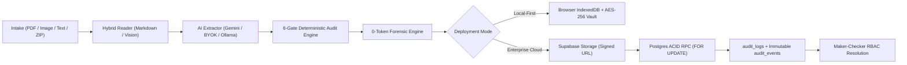

# Architecture & Decision Records

## System Overview

The **AI Invoice & Purchase Order Discrepancy Detector** separates **probabilistic document extraction** (LLMs / Vision / Local Ollama) from **deterministic financial enforcement** (6-Gate Audit Engine + 0-Token Forensic Engine + Postgres ACID RPC).

## Architecture Decision Records (ADRs)

### ADR-001: Deterministic Math & Policy Outside the LLM
- **Context:** LLMs hallucinate arithmetic, tax rounding, and multi-line cumulative quantities.
- **Decision:** Restrict LLMs strictly to structured JSON extraction (`src/invoiceSchema.json`) with anti-prompt-injection rules. All math, tax (`PPN`/`PPh 23`), split-line accumulation, GRN 3-Way Match, and Anti-BEC bank checks run deterministically in `src/auditEngine.js` (~44k invoices/sec, zero token cost).

### ADR-002: Dual-Mode Persistence (Zero-Config Local-First + Multi-Instance Cloud)
- **Context:** Individual AP teams want private, zero-setup browser audits, while enterprises require multi-instance concurrency safety and SOX/ISO 27001 auditability.
- **Decision:** Keep browser IndexedDB + AES-256-GCM `.auditvault` for stateless local mode, and automatically activate Supabase Postgres ACID RPC (`record_audit_and_deduct_po` with `SELECT ... FOR UPDATE`), private Supabase Storage Signed URLs (`src/storageRepository.js`), and Upstash Redis REST atomic rate limiting (`src/apiHelpers.js`) when cloud env vars are present.

### ADR-003: Single Source of Truth for n8n Automation
- **Context:** Maintaining separate JS code inside `workflows/invoice_po_audit_n8n.json` caused rule drift.
- **Decision:** `scripts/buildN8n.js` (`npm run build:n8n`) compiles `src/auditEngine.js`, `prompts/invoice_extraction_prompt.txt`, and `src/invoiceSchema.json` directly into `src/n8nCodeNodeTemplate.js` and `workflows/invoice_po_audit_n8n.json`. GitHub Actions runs `npm run build:n8n -- --check` on every PR.

### ADR-004: Maker-Checker RBAC & Append-Only Audit Trail
- **Context:** Overwriting `audit_status` in-place destroys forensic history for external auditors.
- **Decision:** Record every state transition (`CREATED`, `ESCALATED_TO_CFO`, `MANUAL APPROVED`, `REJECTED TO VENDOR`) in an append-only `audit_events` table, enforce Segregation of Duties (`SOD_VIOLATION`) on self-approval, and escalate approvals above Rp50M to `PENDING_CFO_APPROVAL`.
